# SideRail

SideRail is a Chrome extension that shows your tabs as a vertical list in the browser's side
panel, and helps you keep them in order. I built it for myself: I usually have far more tabs
open than Chrome or Helium's tab strip can cope with, and somewhere along the way I stopped looking at
the tab strip at all. It's free and open source, and I'm sharing it in case it's useful to
anyone else.

The short version: your tabs sit down the side of the window with their full titles, grouped
and sorted the way you want them, and a search box finds any open tab by its title, its
address or (if you allow it) the words on the page. Everything it knows stays on your
computer.

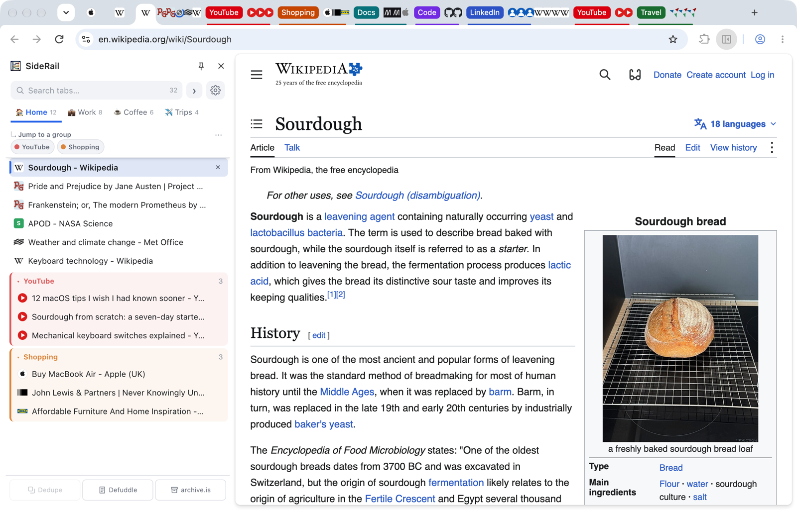

---

## What it does

- **Vertical tabs.** Every tab in the window in one list, with its full title. Drag to
  reorder, right-click to pin, mute, suspend or close, and hover for a preview card (with a
  thumbnail, once you've given SideRail access to pages).
- **Tab groups.** Chrome's own tab groups appear as collapsible sections, with a row of
  shortcuts at the top so you can jump straight to one. A single command gathers every loose
  tab in the window into groups by site.
- **Spaces.** Work, Home, a project, a holiday. A space is a label on a tab rather than a
  separate window, so switching between spaces is instant: nothing closes and nothing
  reloads.
- **Rules.** "Anything on github.com goes into a Code group, in my Work space." You write a
  rule once and SideRail files matching tabs as you browse.
- **Search.** Find an open tab by its title or address as you type, and by the text on the
  page if you let SideRail read pages. Your bookmarks and history can be included too, if you
  allow it. Only tabs that are open now are searched; nothing is kept once a tab closes.
- **Command palette.** One list for jumping to any tab, space or command.
- **Rewind.** A snapshot of your windows every five minutes (the last 50 are kept), so a
  crash or an accidentally closed window costs you very little. A snapshot always restores
  into a new window, so it can't overwrite what you have open.
- **Odds and ends.** A duplicate-tab finder that shows you what it would close before it
  closes anything, a clean reader view of most pages (using
  [Defuddle](https://github.com/kepano/defuddle)), and a one-click jump to an archived copy
  on archive.is.

It's open source under the Apache License 2.0. For now it lives here on GitHub rather than in
the Chrome Web Store, although I intend to publish it there too. Until then you install it by
hand (it takes a couple of minutes; see [Install](#install)), and it doesn't update itself, so
nothing about it changes until you choose to update. It runs in Chrome and in other
Chromium-based browsers, including Brave, Edge, Vivaldi and Helium (which is what I use).

---

## Install

I've not yet deployed SideRail to the Chrome Store (but am intending to). Until then SideRail is installed manually from GitHub.

1. Download the latest `SideRail-<version>.zip` from the
   [releases page](https://github.com/RobinLandy/SideRail/releases) and unzip it somewhere
   permanent, not Downloads: the browser loads SideRail from this folder every time it starts.
   `~/SideRail` is fine. A git clone of this repository works the same way.
2. Open `chrome://extensions`.
3. Turn on **Developer mode** (top right).
4. Click **Load unpacked** and select the folder containing `manifest.json`.
5. Pin SideRail to the toolbar. Click the icon to open and close the panel.

Chrome then shows a "Disable developer mode extensions" warning when it starts. It's
cosmetic: dismiss it and SideRail keeps working.

### Updating

SideRail never checks for new versions. To hear about them, choose **Watch → Custom →
Releases** on this repository, or look at Settings → About → Releases now and then. To update:

1. Download the new zip and unzip it.
2. Replace the **contents** of your SideRail folder with the new files.
3. On `chrome://extensions`, press the reload arrow on SideRail's card.

Your spaces, rules, snapshots and settings are kept by the browser, not in the folder, so they
survive an update. (From a git checkout, `git pull` and the reload arrow do the same job.)
Don't press **Remove** first: removing an extension deletes its data, and you never need to,
because loading a new copy over the top keeps it.

---

## Finding your way around

The panel has two screens. The **tab list** is where you spend your time. **Manage
SideRail**, behind the cog, is where you set things up, and its back arrow returns you to the
tab list exactly as you left it.

The tab list, from top to bottom:

- **Search.** The box filters your tabs as you type and shows how many are open. The **›**
  beside it opens the command palette.
- **Spaces.** One entry per space, with its emoji and how many tabs it holds. Click to switch;
  drop tabs on one to move them there.
- **Pinned tabs** for the space you're in, as small tiles. Drag to reorder, or drag a tab onto
  the row to pin it.
- **Jump to a group.** One capsule per tab group: click to scroll to it, drag to reorder.
  The **⋯** on this row holds the window-wide actions: group tabs by site, ungroup everything,
  run your rules now, save the window as a space, export or import your data.
- **The tabs**, with tab groups as collapsible sections.
- **Three buttons along the bottom:** Dedupe, Defuddle (the reader view) and archive.is.

Manage SideRail has four sections: **Spaces**, **Rules**, **Rewind** and **Settings**. Each
has its own filter box, separate from the tab search, and everything in them can also be
reached from the command palette.

### Using the panel

- **Click** a tab to switch to it.
- **Cmd/Ctrl+click** to select several, **Shift+click** for a range.
- **Middle-click** or the **×** to close.
- **Right-click** for pin, mute, suspend, duplicate, copy the address, move to a new window or
  another space, and close others or close the tabs below.
- **Drag** to reorder. Dragging a selected tab moves the whole selection.
- **Click a group header** to collapse it; right-click it to rename, ungroup or close the
  group. Renaming a group that a rule made renames the rule too.
- **Esc** clears the search box, then the selection.

### Keyboard shortcuts

| Key | macOS | Does |
|---|---|---|
| `Alt+B` | `⌘⇧B` | Open the panel |
| `Alt+G` | `⌘⇧G` | Group ungrouped tabs by site |
| `Alt+Shift+G` | not set | Ungroup everything |

Change them at `chrome://extensions/shortcuts` (Settings → Keyboard takes you there). The
command palette has no shortcut; it opens from the **›** button beside the search box.

---

## Spaces

<p>
  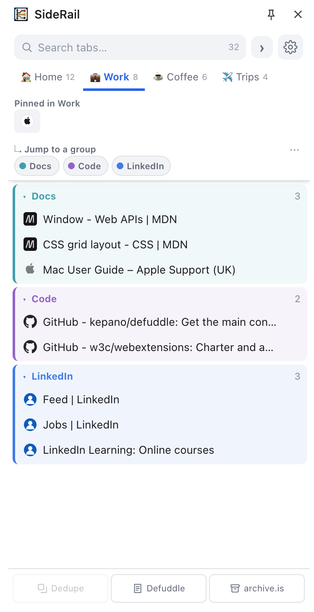
  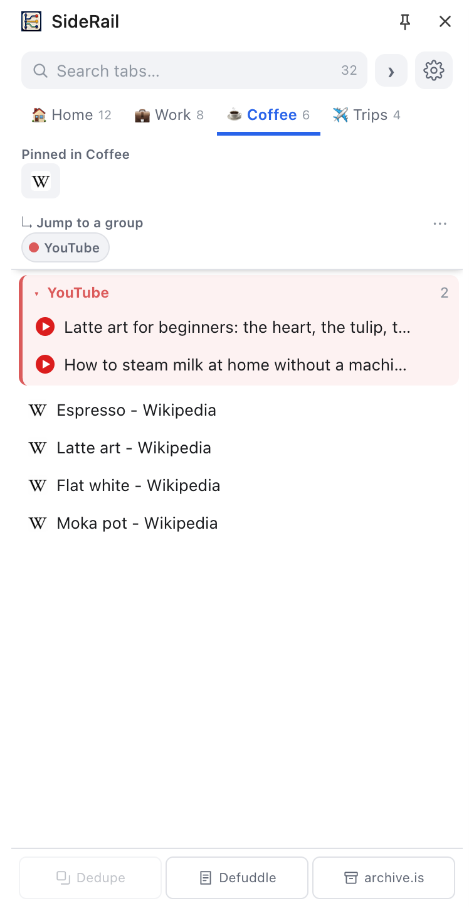
</p>

A space is a **label on a tab**, not a separate window, so switching between spaces is
instant: nothing is closed, moved or reloaded, and you never lose a scroll position or a
half-typed form.

- **Switch** from the row of spaces above the list. Drag a tab onto a space to move it there,
  or right-click a tab (or a selection) and choose **Move to**.
- **Create, rename, reorder and delete** spaces in Manage SideRail → Spaces. Deleting a space
  never closes a tab; its tabs go back to Main.
- **Main** is where everything starts. It's always first, can be renamed but not deleted, and
  a tab that belongs nowhere else returns to it.
- **New tabs**, including ⌘T, open in the space you're looking at.
- **The panel follows the browser.** Switch to a tab from another space and the panel goes
  there with you.
- **Private.** Mark a space Private and nothing in it is read by page-text search.

**Pinned tabs are per space**, as in Arc. Right-click one for **Pin in every space** to have it
appear everywhere, marked with a small dot. There is only ever one real tab, so closing a
pinned tab closes it everywhere.

**Each space gets its own groups.** If a rule makes a Travel group, Work's Travel group and
Home's Travel group are separate, and collapse separately.

**After a restart**, Chrome gives every tab a new identity, so SideRail puts tabs back in their
spaces by matching their addresses against each space's saved list; anything no space claims
goes to Main. If Chrome doesn't restore your tabs after a crash, each space still shows what it
had, with a **Reopen** button.

---

## Rules

<p>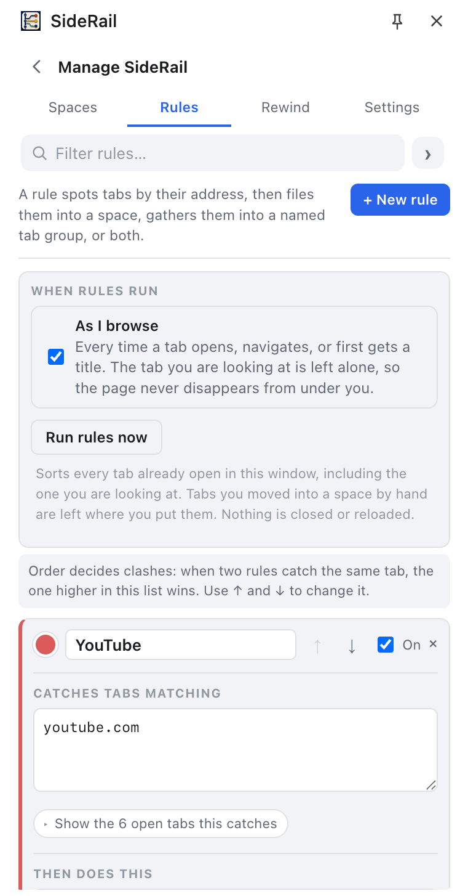</p>

A rule is **a match plus up to two actions**: file matching tabs into a space, and put them in
a named tab group. Either action can be left blank. "YouTube goes to Entertainment, inside a
YouTube group" is one rule.

Patterns, one per line:

| You type | It matches |
|---|---|
| `booking.com` | the site and its subdomains (`www.`, `secure.`), but **not** `elsewhere.com/?ref=booking.com` or `notbooking.com` |
| `jira` | anywhere in the address (no dot, so it reads as a keyword) |
| `/trips/` | anywhere in the address (it contains a slash) |
| `*.expedia.*` | a glob: `*` is a wildcard |
| `/^https:\/\/(www\.)?airbnb\./i` | a regular expression |
| `title:SideRail` | the tab's **title** rather than its address |
| `title:/^Inbox/i` | a regular expression against the title |

A bare pattern matches the address. One rule can mix patterns (`title:invoice` alongside
`stripe.com`), and a tab matching any of them is caught.

**When rules run.** With **As I browse** switched on (the default), rules run when a tab opens,
navigates or first gets a title. Two kinds of tab are left alone: the one you're looking at,
which is filed once you move on so the page never disappears from under you, and any tab you
moved into a space by hand. **Run rules now** (in Manage SideRail → Rules, or the **⋯** menu)
sorts every tab already open in the window, including the one you're on.

**When two rules want the same tab**, the one higher in the list wins; ↑ and ↓ on each card
change the order. If two rules are fighting over tabs you have open, the losing one says so on
its card, with a **Put this rule first** button.

**Rules never touch a tab group you named by hand.**

Each rule card shows how many open tabs it matches, and you can expand that to see which.
Click the colour swatch to recolour the rule's groups, and untick a rule to switch it off
without deleting it. Deleting a rule that holds tabs asks whether to ungroup them or keep the
groups; nothing is closed either way. Right-click any tab for **New rule for &lt;site&gt;**, or
a group header for **Make a rule from this group**.

---

## Searching

Type in the search box and the list narrows to tabs whose title or address matches, as you
type. Every word has to match, so adding words narrows the list, and initials work too (`gd`
finds Google Docs). Below the matching tabs, the results carry on in sections:

1. **Page text:** open tabs whose page mentions what you typed, even though the title and
   address don't. This needs permission to read pages; see below.
2. **Bookmarks** and **History**, if you've allowed SideRail to see them. Each bookmark shows
   the folder it lives in.
3. **Web:** a search engine search, as a last resort.

### Searching the text of open tabs

SideRail can't read pages when you install it. The first time you search, a box offers to ask
for that permission; Chrome asks once, for all sites, never site by site.

<p>
  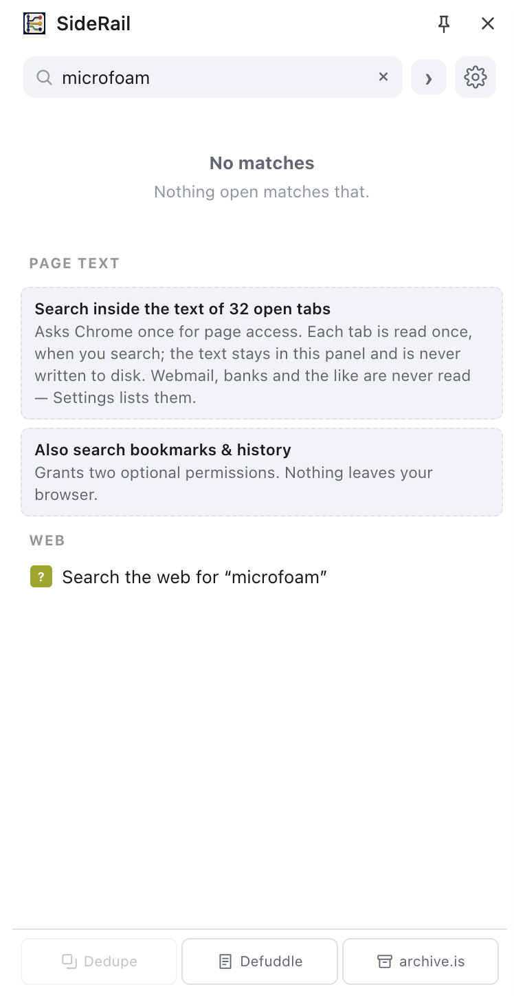
  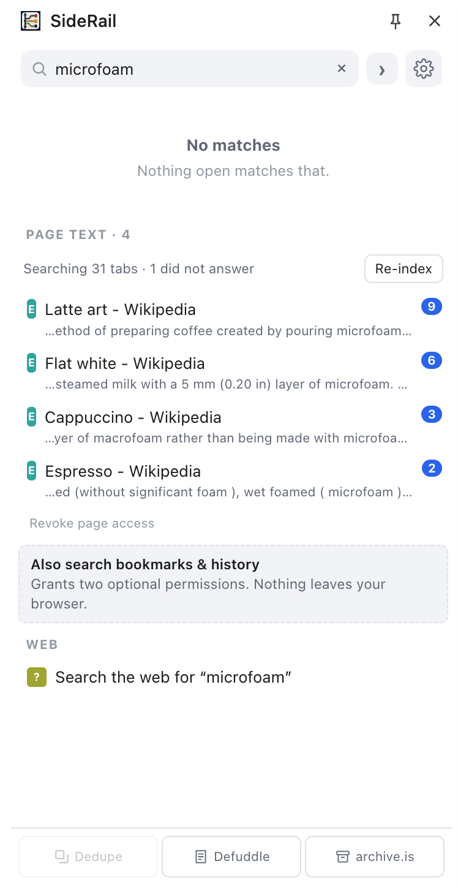
</p>

Each open tab is read once. A small reader is put into the tab, hands back the visible text
(without menus, headers and footers) and is removed; after that, every keystroke searches the
panel's own copy, so results appear as you type. Tabs Chrome has put to sleep can't be read
without waking them, so the results say how many there are, and a button wakes them, reads
them and puts them back to sleep.

Only open tabs are searched, the text is never stored, and banks, webmail and some 18,000
other sites are never read. [Privacy and permissions](#privacy-and-permissions) has the
details.

---

## The command palette

<p>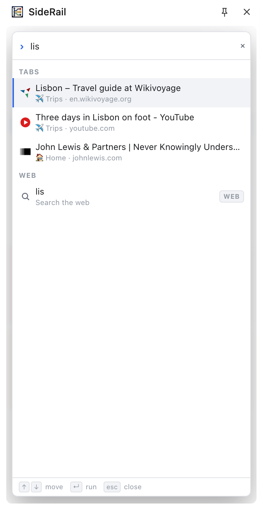</p>

The **›** button beside the search box opens one ranked list over everything: **open tabs**
from every window (each showing which space it's in), **spaces** to switch to, **commands**,
and **bookmarks and history** if you've allowed them. Empty, it offers recent tabs and the
commands you're most likely to want.

The top line reads what you type as either somewhere to go or something to search for:

| You type | You get |
|---|---|
| `bbc.co.uk/news` | **Open** first: it's clearly an address |
| `bbc.co.uk news` | **both**: open `bbc.co.uk`, or search for the whole phrase, one arrow key apart |
| `how do tab groups work` | a search, and matching tabs |
| `localhost:3000`, `192.168.1.1` | **Open**: these are places |
| `v1.2.3`, `3.5`, `someone@example.com` | a search: dots alone don't make an address |

A web search is always offered at the bottom, but a single word never selects it ahead of a
tab you have open. ↑ and ↓ (or `Ctrl+N` and `Ctrl+P`) move, `Home` and `End` jump, ↵ runs and
`Esc` closes.

---

## Rewind

Every five minutes SideRail records what's open in each window, and which space each tab was
in, keeping the last 50 snapshots. Nothing is recorded when nothing has changed, so a quiet
evening doesn't push useful snapshots out. From any snapshot you can **Restore** it into a new
window (never over the top of what you have), **Re-pin** just the tabs that were pinned, or
**Keep as a space**. **Take one now** records one by hand.

<p>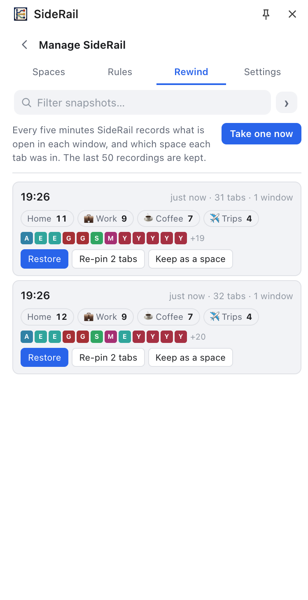</p>

A snapshot records each tab's address, title, pinned and muted state, tab group and space,
along with your spaces' names and emoji, so a restore can bring back a space you've since
deleted. Restored tabs stay where the snapshot put them; rules don't move them. Rules,
settings and the order of the jump bar aren't in snapshots: for those, use Export (see
[Backing up](#backing-up)).

### Backing up

Your spaces, rules, snapshots and settings are kept by the browser, not in SideRail's folder.
They survive updates and moving the folder, but not pressing **Remove**, moving to another
computer, or switching to a copy from the Chrome Web Store (which the browser treats as a
different extension). To keep a copy, **Export data** in Manage SideRail → Settings → Your
data writes a file with everything; **Import data** reads it back, replacing only what's in
the file.

---

## Smaller features

### Dedupe

Dedupe finds tabs open at the same address and shows them to you before closing anything. It
suggests a copy to keep (the tab you're on, otherwise the one with the tidiest address,
otherwise the leftmost) and ticks the rest; you adjust the ticks and press Close, or Cancel.
Tracking parameters such as `utm_source` and `fbclid` are ignored when comparing addresses, as
is the order of the rest, so a link opened from a newsletter counts as a copy of the tab you
already had. Pinned tabs are never included.

<p>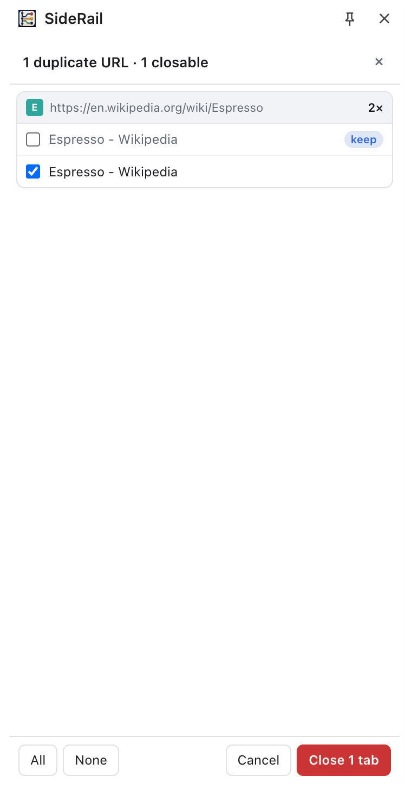</p>

### Reader view and archive.is

**Defuddle** (the button at the bottom, or a tab's right-click menu) turns the page into a
clean reader view: the article's text, title, byline, images and code, without navigation,
sidebars and footers. **Restore original** at the top, or reloading, puts the page back. It
needs page access. **archive.is** reloads the tab at `https://archive.is/<its address>` and
needs no permission.

### Hover previews

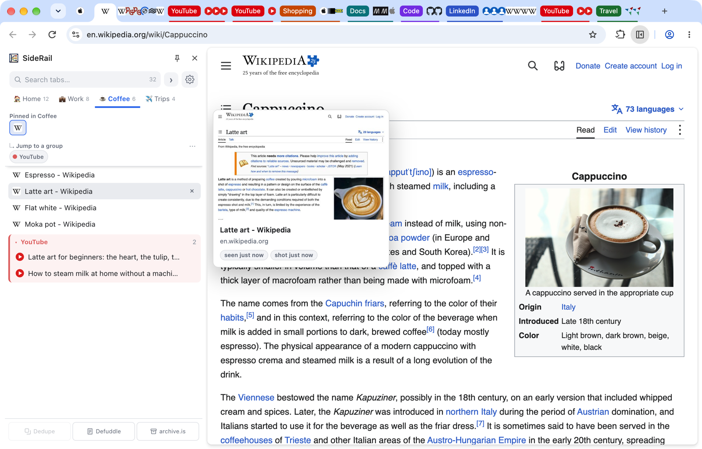

Hover over a tab for a moment and a card shows its full title, its site, a thumbnail of the
page, and its state: pinned, asleep, playing audio, muted, its group, and when you last saw
it. Thumbnails need page access and are taken when you visit a tab, so a tab you haven't
visited since the browser started has none yet, and the card says so. The card is drawn beside
the panel, inside the page you're looking at; on pages Chrome doesn't let extensions draw on
(`chrome://` pages, the Web Store, `file:` pages), it's drawn over the tab list instead.

---

## Privacy and permissions

A tab manager can see everything you have open, which is a lot to hand over to someone else's
software. So I've tried to make SideRail easy to check, rather than something you have to
take on trust. In short: it makes no network connections of its own, it can't read web pages
until you use a feature that needs to, it never stores the text of pages, and what it does
keep stays in this browser profile. [PRIVACY.md](PRIVACY.md) sets all of this out in full.

### It makes no network connections

No analytics, no telemetry, no crash reporting, no update check. The test suite fails the
build if any shipped file tries to open a connection. The only requests SideRail can cause
are tabs you ask it to open: the web search at the bottom of the results (DuckDuckGo, unless
you change `WEB_SEARCH` at the top of `sidepanel.js`), **archive.is**, and the Releases and
Report a problem links in Settings → About, which go to GitHub.

### What it asks for

```
tabs         read and manage your tabs
tabGroups    read and manage Chrome's tab groups
sidePanel    show the panel
storage      keep spaces, rules, snapshots and settings
alarms       the five-minute snapshot timer
```

And three that are off until you use a feature that needs them, each asked for once:

```
bookmarks    search your bookmarks
history      search your history
scripting    read pages: page-text search, hover thumbnails and the reader view.
<all_urls>   One prompt, for all sites.
```

The manifest has no `host_permissions` and no `content_scripts`, so SideRail can't read a page
until you grant page access, and even then never leaves a script running in your pages. Take
the grant back in Settings → Page access, or on `chrome://extensions`. SideRail doesn't ask to
see your other extensions (no `management` permission) and doesn't change the security
headers of pages you visit (no `declarativeNetRequest`).

### What it keeps, and where

- **In the browser's storage on this computer:** your spaces (including the addresses and
  titles of their tabs, which is how they survive a restart), rules, Rewind snapshots (also
  addresses and titles), settings and the order of the jump bar. This is what Export writes
  out. No website or other extension can read it, and nothing goes into Chrome's sync storage,
  so none of it follows you to another computer.
- **In memory only, gone when the browser closes:** which space each open tab is in, and the
  hover thumbnails (at most 50, and 4.5 MB in all).
- **In the panel's memory only:** the text page-text search reads. It's dropped when its tab or
  the panel closes, and never written to disk, sent anywhere or included in Export. Card
  numbers, IBANs, account numbers, National Insurance and Social Security numbers are removed
  even from that copy.

### What it never reads

Banks, card issuers, insurers, webmail, personal messaging, dating, payment and health
services, password managers and government services are on a built-in list of about 18,000
sites, derived from the UT1 blacklists with additions for what they miss. Sign-in and account
pages (`accounts.`, `login.`, `myaccount.` and so on) and search engine results are skipped
too, under the same switch. An address that carries a password, token or sign-in code is
never read, whatever the switch says. You can add your own sites in Settings, under *Pages
that are never read*, or mark a whole space **Private**. A page can also decline on its own
(`noindex`, a payment form or a login page), and the results say which tabs were not read and
why. Team chat such as Slack, Discord and Teams is deliberately not on the list: it's exactly
what you tend to want to find.

<p>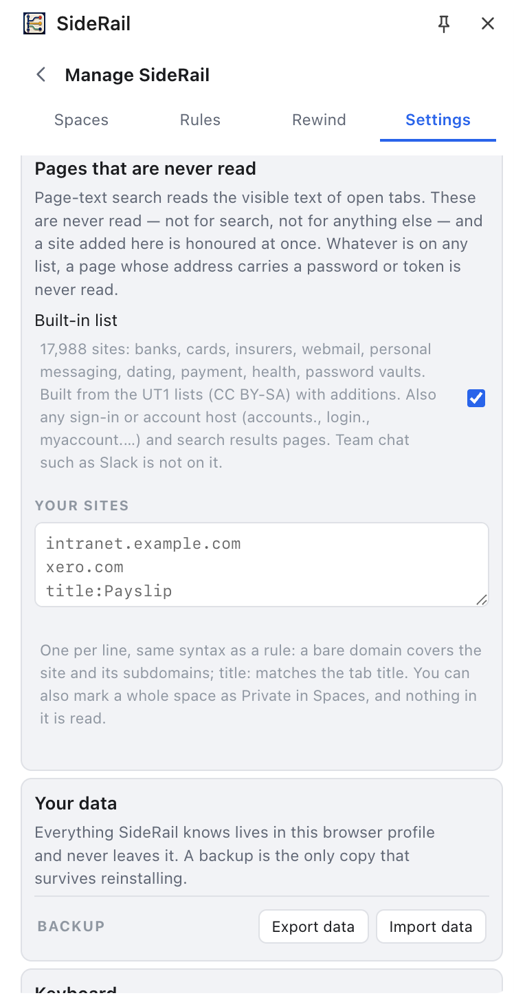</p>

### Taking it back

- **Revoke page access** in Settings → Page access. Searching page text, thumbnails and the
  reader view stop until you grant it again.
- **An export file** holds the addresses and titles of your tabs; look after it accordingly.
- **Copy diagnostics** (Settings → Advanced) puts a report on your clipboard for bug reports:
  the version, your space and rule names, and the site name of every open tab, but no titles or
  full addresses. Read it before you paste it anywhere.
- **Removing SideRail** from `chrome://extensions` deletes everything it stored.

---

## Known limits

- **The panel's width is Chrome's.** Chrome sets a minimum of about 360px and doesn't let
  extensions change it.
- **The panel can't render over `chrome://` pages**, a limit of Chrome's side panel.
- **`Alt+B` opens the panel but can't close it.** Chrome has no way to close it from a
  shortcut; the toolbar button toggles it.
- **Restoring a large space loads every tab at once.** Chrome can't create a tab already
  asleep, so a 50-tab space takes a moment.
- **Snapshots cover normal windows only**; incognito windows are left out.
- **One window at a time.** The panel shows the window it lives in, which is how Chrome's side
  panel works.
- **A page can refuse to close.** If a page asks "Leave site?", the tab stays until you answer,
  and SideRail says the page is asking to stay open.

---

## For developers

SideRail is plain JavaScript modules with no build step: edit a file, press the reload arrow on
`chrome://extensions`, and you're done. A few things worth knowing are set in the code:

- `WEB_SEARCH` in `sidepanel.js`: the fallback search engine.
- `MAX_SNAPSHOTS` in `common.js`: how many snapshots Rewind keeps (50).
- `periodInMinutes` in `background.js`: how often a snapshot is taken (5).
- `--accent` and the `--g-*` group colours in `sidepanel.css`.

### Files

```
manifest.json               every permission SideRail asks for
background.js               service worker: shortcuts, the snapshot timer, rules as you browse, the duplicate scan
common.js                   shared helpers: addresses, search, the rule engine, snapshots, spaces
sidepanel.html, .css, .js   the panel
icons/                      app and toolbar icons
vendor/                     Defuddle (pinned), the emoji table, the never-read list
LICENSE, NOTICE             the Apache 2.0 licence, and the name and icon it doesn't cover
THIRD-PARTY-NOTICES.md      licences of what ships inside the package
PRIVACY.md                  what is kept, where, and what never happens
SECURITY.md                 how to report a security problem
CHANGELOG.md                what changed in each version, and why
docs/screenshots/           the images in this README (not shipped in the package)
tools/package.mjs           builds the release zip from an allow-list
tools/build-exclusions.mjs  rebuilds the never-read list from the UT1 lists and the additions
tools/build-emoji.mjs       rebuilds the emoji table
tools/update-defuddle.mjs   checks for, and vendors, a newer Defuddle
test/e2e.js                 the end-to-end suite: drives the real extension in a Chromium browser
test/geometry.js            measures the panel's layout at several widths
test/bh.js                  bookmarks and history, with those permissions pre-granted
test/lint.js                static checks: imports, no network calls, no database, no control characters
test/shot.js                renders panel screenshots
```

### Running the tests

```bash
npm install            # once
npm run lint           # static checks, instant
npm test               # lint, the end-to-end suite and the layout suite
npm run test:data      # bookmarks and history
npm run package        # builds dist/SideRail-<version>.zip
```

The tests need a Chromium-family browser. They use `CHROME_BIN` if it's set, otherwise Helium,
Chrome or Chromium in the usual macOS locations:

```bash
CHROME_BIN="/Applications/Helium.app/Contents/MacOS/Helium" npm test
```

Google Chrome itself can't run the suite: branded builds from 137 onwards ignore the flag that
loads an unpacked extension. Use Chromium, Helium or Chrome for Testing
(`npx playwright install chromium` downloads one). To skip Playwright's own browser download,
install with `PLAYWRIGHT_SKIP_BROWSER_DOWNLOAD=1 npm install`.

The suite also checks that the manifest still asks for no host permissions and no content
scripts, that no shipped file makes a network call or opens a database, and that the release
zip holds exactly what it should.

### Updating Defuddle

Defuddle is pinned in `vendor/defuddle.js`. `npm run update:defuddle` reports whether a newer
release exists; `node tools/update-defuddle.mjs --apply` vendors it and bumps SideRail's
version. Run the tests afterwards.

### Contributing

Issues and pull requests are welcome. Before opening a pull request, run `npm test` and add a
check for what you changed. Contributions are accepted under the Apache License 2.0, which
covers patents and needs no separate agreement; the name and icon stay with the project (see
`NOTICE`). Bug reports are most useful with the diagnostics from Settings → Advanced (see
[Taking it back](#taking-it-back) for what they contain).

---

## Licence, third-party software and warranty

SideRail is released under the **Apache License 2.0**; the full text is in
[LICENSE](LICENSE). [NOTICE](NOTICE) explains that the name and icon are not part of that
licence, so a fork should use its own.

It includes three pieces of other people's work, each under its own licence. The notices are
reproduced in [THIRD-PARTY-NOTICES.md](THIRD-PARTY-NOTICES.md), which ships inside every
release:

- **[Defuddle](https://github.com/kepano/defuddle)**, by Steph Ango, which extracts the
  article for the reader view. MIT licence.
- **Unicode emoji data**, for the emoji picker when you name a space. Unicode License V3.
- **The UT1 blacklists**, maintained by Université Toulouse Capitole, which the built-in
  never-read list is derived from. Creative Commons Attribution-ShareAlike (CC BY-SA); the
  derived list in `vendor/exclusions.js` is under the same licence.

**No warranty.** SideRail is provided "as is", without warranties or conditions of any kind,
and without liability for any loss or damage that comes from using it. Sections 7 and 8 of
the licence set out the terms in full. In short: you use it at your own risk.
